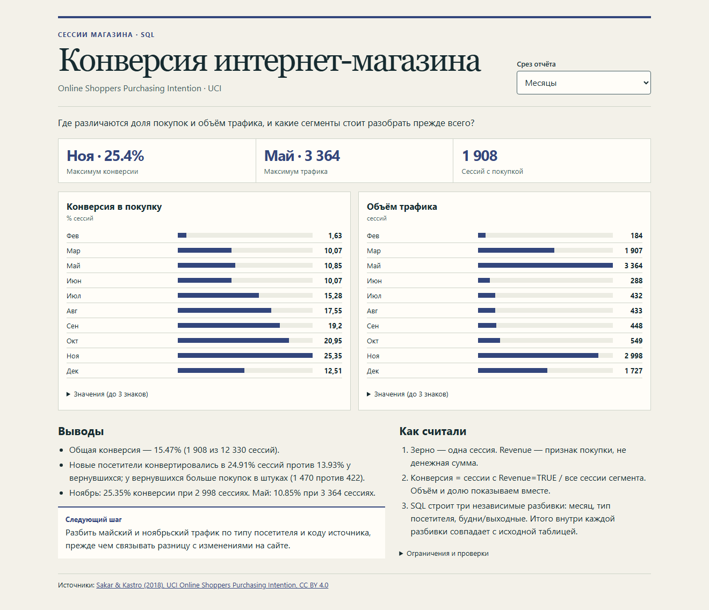

# Конверсия сессий интернет-магазина

Покупкой закончились 1 908 из 12 330 сессий (15,47%). SQL считает конверсию по месяцу, типу посетителя и выходным; различия между срезами сами по себе не объясняют причину покупки.

[HTML-отчёт](dashboard.html) · [Сводка CSV](summary.csv)



## Выводы

- Общая конверсия — 15.47% (1 908 из 12 330 сессий).
- Новые посетители конвертировались в 24.91% сессий против 13.93% у вернувшихся; у вернувшихся больше покупок в штуках (1 470 против 422).
- Ноябрь: 25.35% конверсии при 2 998 сессиях. Май: 10.85% при 3 364 сессиях.

**Следующий шаг:** Разбить майский и ноябрьский трафик по типу посетителя и коду источника, прежде чем связывать разницу с изменениями на сайте.

## Методика

- Зерно — одна сессия. Revenue — признак покупки, не денежная сумма.
- Конверсия = сессии с Revenue=TRUE / все сессии сегмента. Объём и долю показываем вместе.
- SQL строит три независимые разбивки: месяц, тип посетителя, будни/выходные. Итого внутри каждой разбивки совпадает с исходной таблицей.

## Ограничения

- Это наблюдения, а не эксперимент: состав и источники трафика могут отличаться.
- В файле нет января и апреля; отсутствие месяца не трактуем как ноль. Нет последовательности событий, поэтому воронку и отток по шагам не оцениваем.
- Выборка собрана для исследования и не обязана повторять структуру полного трафика сайта. Малые сегменты сильнее реагируют на случайные колебания.

## Контроль качества

- 12 330 сессий и 1 908 покупок совпадают с UCI
- Все покупки и сессии сохранены в каждой разбивке
- Каждая доля пересчитана из числителя и знаменателя

## Как пересчитать

- `analyze.py` — загрузка источника, расчёт и сверки.
- `summary.csv` — агрегаты рассчитанных срезов.
- `case.json` — значения и текст отчёта.
- `analysis.sql` — SQL-логика формирования аналитических срезов.

Запустить из этой папки (Python 3.11+, для Excel также `uv`):

```bash
python analyze.py
```

Расчёт скачивает открытый источник. Для просмотра уже собранной версии скачайте `dashboard.html` и откройте его в браузере.

## Источники

- [Sakar & Kastro (2018), UCI Online Shoppers Purchasing Intention, CC BY 4.0](https://archive.ics.uci.edu/dataset/468/online%2Bshoppers%2Bpurchasing%2Bintention%2Bdataset)
